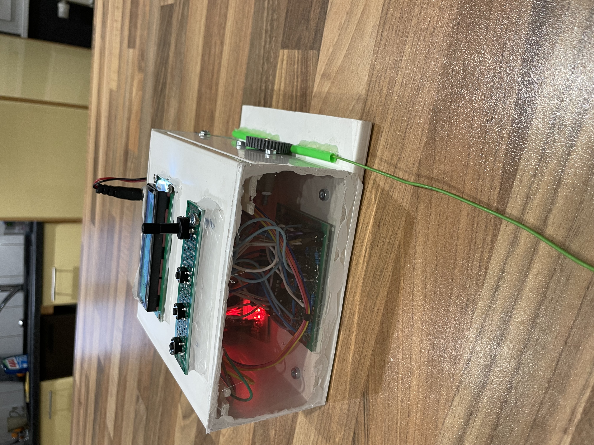

# 🔌 Automatic Cable Length Dispenser

## 🎯 Objective
Automate the process of unwinding and cutting cables to a predefined length, with the ability to repeat the cycle as needed.

---

## ⚠️ Problem
Manual cable cutting is slow, inconsistent, and prone to measurement errors, especially when producing multiple identical pieces.

---

## 💡 Solution
I designed a system that:
* Allows the user to set a target length using physical buttons.
* Automatically unwinds the cable to the exact requested length.
* Uses an electronic motor control and a length-measurement sensor.
* Repeats the operation reliably for series of cables.

---

## 📈 Results
* Consistent and repeatable cable lengths.
* Significant time saved on batch tasks.
* Elimination of human measurement errors.
* Practical setup for producing identical cable segments.

---

## 🛠️ Skills Demonstrated
* Motor control
* User interface design (buttons and display)
* Automated length measurement
* Mechanical and electronic system integration
* Development of repeatable processes

---

## 📷 System Preview

  

