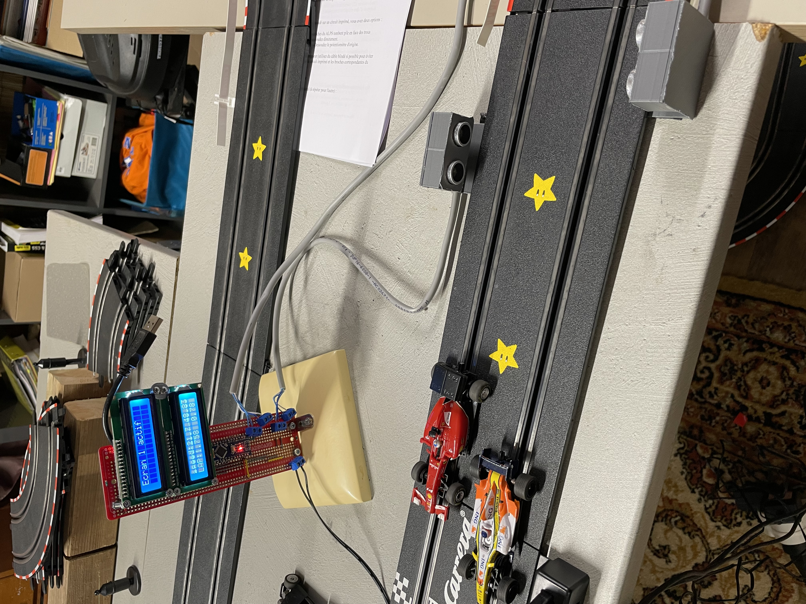

# 🏎️ Lap Timing System for Miniature Racing Cars

## 🎯 Objective
Design and implement an automated, a system capable of detecting miniature racing cars on a racetrack and calculating real-time performance metrics.

---

## 💡 Developed Solution
An end-to-end embedded system featuring:
* **Automated Detection:** Real-time car detection at the finish line.
* **High-Precision Timing:** Accurate lap time tracking down to the millisecond.
* **Performance Analytics:** Automated calculation of average lap speed and historical tracking.
* **Personal Best Tracking:** Instant identification and logging of the fastest laps.
* **Live On-Screen Display:** Continuous, real-time visualization of telemetry data on a dedicated screen.

---

## 📈 Results & Impact
* ⏱️ **High Accuracy:** Reliable, real-time lap measurements with zero human intervention.
* 📊 **Enhanced Telemetry:** Clear, permanent dashboard display for immediate driver feedback.
* 🔄 **Optimized Testing:** Streamlined performance comparison between consecutive laps and different vehicle setups.
* 🏁 **Race-Ready:** Robust design suitable for racing events and iterative testing phases.

---

## 🛠️ Skills Demonstrated
* **Sensor Integration & Signal Processing**
* **Real-Time Embedded Computation**
* **Embedded Display Programming**
* **Performance Data Analysis & Telemetry**
* **End-to-End System Architecture** *(Detection rightarrow Processing rightarrow Display)*

---

## 📷 System Preview

  

