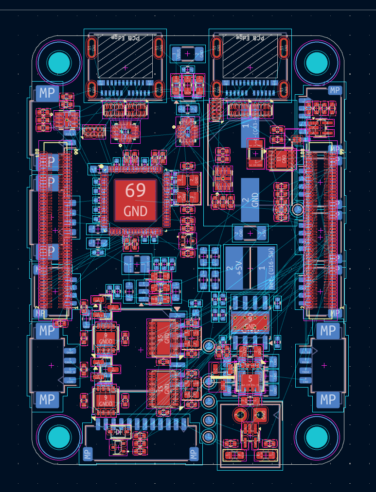
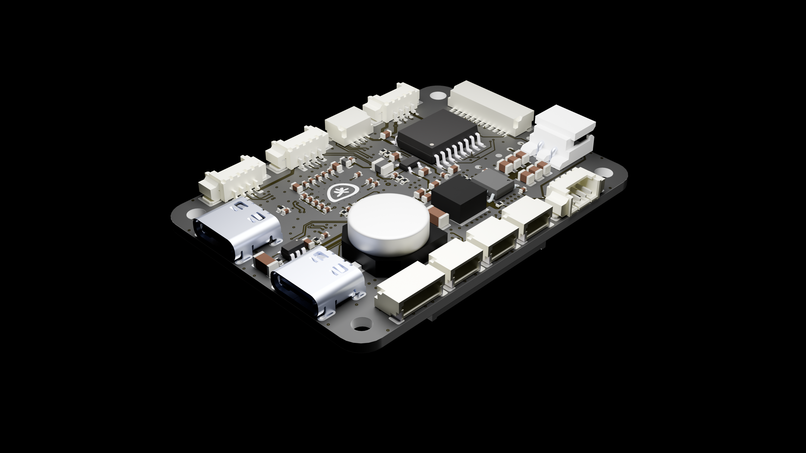
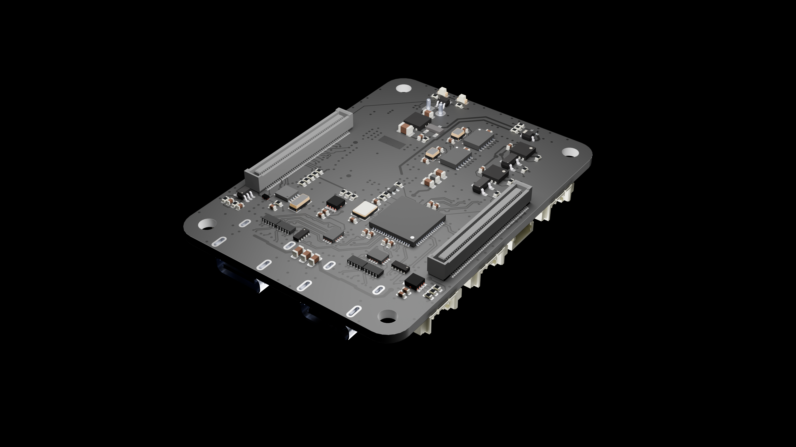

# 🛠️ Reverse Engineering & PCB Redesign – Internship at KM-Robota

Welcome to this repository! This project showcases the work I carried out during my internship at **KM-Robota** in Lausanne, Switzerland. 

The primary objective was to reverse engineer an existing Printed Circuit Board (PCB) using only its final manufacturing files and redesign it into an editable, future-proof format with high-quality visual assets.

---

## 📌 Project Overview

When starting the project, the only available documentation for the original PCB was its **Gerber files**—the finalized, non-editable output files used for manufacturing. To make future hardware updates and modifications possible, I undertook a complete reverse engineering process to recreate the board from scratch in **KiCad** and produce photorealistic 3D renders for professional presentation.

---

## 🔑 Key Contributions & Workflow

1. **Reverse Engineering & Gerber Analysis**
   * Extracted copper layers, silkscreens, solder masks, and drill files directly from the original Gerber data.
   * Reconstructed the complete schematic and circuit topology by analyzing trace routings and component placements.

2. **Full PCB Redesign (KiCad)**
   * Re-created the full schematic diagram with validated component parameters.
   * Designed a fully editable **KiCad PCB layout**, making future hardware iterations and component upgrades straightforward for the team.

3. **3D Asset Creation & Photorealistic Rendering (Blender)**
   * Exported the 3D model of the board and imported custom CAD component models.
   * Created **photorealistic 3D renders using Blender**, setting up advanced materials, textures, and studio lighting to produce high-end visual assets for documentation and presentation purposes.

---

## 🛠️ Tools & Technologies Used

| Category | Tools |
| :--- | :--- |
| **EDA / CAD** | KiCad (Schematic Capture & PCB Layout) |
| **Reverse Engineering** | Gerber Viewers, Layer Reconstruction Tools |
| **3D Visualization** | Blender (Cycles Rendering, Lighting, Shading) |

---

## 📷 Visuals & Renders

---

## 🏢 Context

* **Company:** KM-Robota
* **Location:** Lausanne, Switzerland
