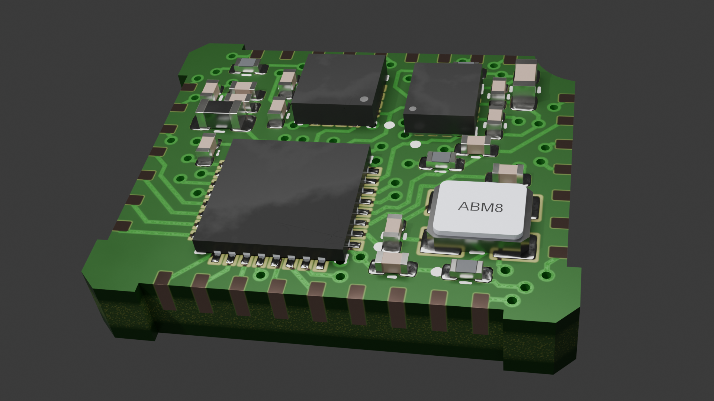

# 🎯 Custom IMU Sensor Prototype – Internship at KM-Robota

This section details the design and development of a custom **Inertial Measurement Unit (IMU)** prototype, developed during my internship at **KM-Robota** in Lausanne, Switzerland.

---

## 📌 Project Overview

The objective was to design a tailored IMU sensor board from the ground up to meet specific robotic hardware integration requirements. Starting without existing hardware schematics, I analyzed manufacturer datasheets and technical specifications to select the optimal components, design the circuit, and validate the initial prototype.

---

## 🔑 Key Contributions & Workflow

1. **Requirements Analysis & Component Selection**
   * Studied datasheets and technical documentation for various MEMS accelerometers, gyroscopes, and magnetometers.
   * Evaluated communication protocols (I2C / SPI), voltage levels, filtering requirements, and power consumption constraints.

2. **Schematic & Hardware Design**
   * Designed the complete schematic using **KiCad**, integrating decoupling capacitors, pull-up resistors, and recommended manufacturer application circuits.
   * Created custom component footprints and managed pinout constraints for micro-controller interfacing.

3. **Prototyping & Validation Strategy**
   * Created layout routing guidelines for high signal integrity and minimal noise/interference on sensitive analog/digital lines.
   * Documented sensor calibration procedures and register configurations for firmware implementation.

---

## 🛠️ Tools & Skills Applied

| Category | Details |
| :--- | :--- |
| **Hardware / EDA** | KiCad (Schematic Design & Footprint Creation) |
| **Engineering** | Datasheet Analysis, Component Selection, Circuit Design |
| **Protocols & Interfaces** | I2C, SPI, Power Management |

---

## 🏢 Context

* **Company:** KM-Robota
* **Location:** Lausanne, Switzerland
