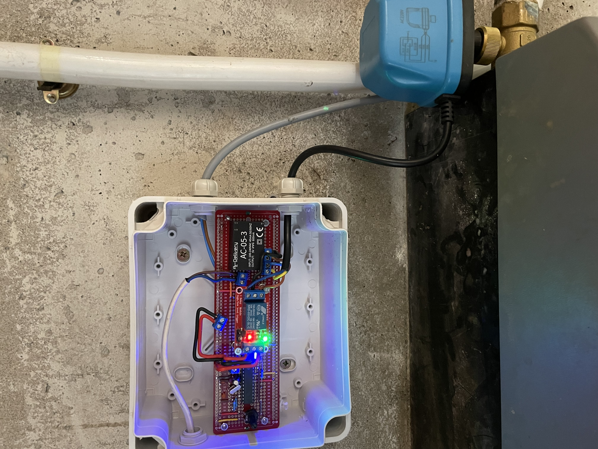

# 🚰 Automatic Water Tank Shut-Off System

## 🎯 Objective
Design and implement a reliable, automated electronic control system to prevent household water tank overflows by accurately cutting off the water supply once maximum capacity is reached.

---

## ⚠️ Problem Statement
The legacy mechanical level-control mechanism was highly imprecise and prone to failure. It frequently failed to trigger at maximum capacity, leading to water wastage, unnecessary costs, and potential structural water damage.

---

## 💡 Developed Solution
An intelligent electromechanical control system featuring:
* **Water Level Sensing:** Precise real-time detection of fluid levels inside the tank.
* **Microcontroller Logic:** Central processing unit to evaluate sensor feedback and trigger safety protocols instantly.
* **Automated Valve Control:** High-reliability solenoid valve actuation to cut off water flow the moment maximum capacity is detected.

---

## 📈 Key Results & Impact
* 🛑 **Zero Overflow:** Complete elimination of water spillage and resource waste.
* ⚡ **High Reliability:** Autonomous, instant response cycle with zero manual intervention required.
* 🛠️ **Low Maintenance:** Robust electronic architecture replacing failure-prone mechanical components.
* 🔄 **System Modernization:** Successful retrofit and full replacement of an outdated mechanical system.

---

## 🛠️ Skills Demonstrated
* **Embedded System Architecture**
* **Fluid Sensor Integration & Signal Processing**
* **Electromechanical Control & Actuation**
* **Solenoid Valve Interfacing & Power Management**
* **Hardware Troubleshooting & System Optimization**

---

## 📷 System Preview

  

